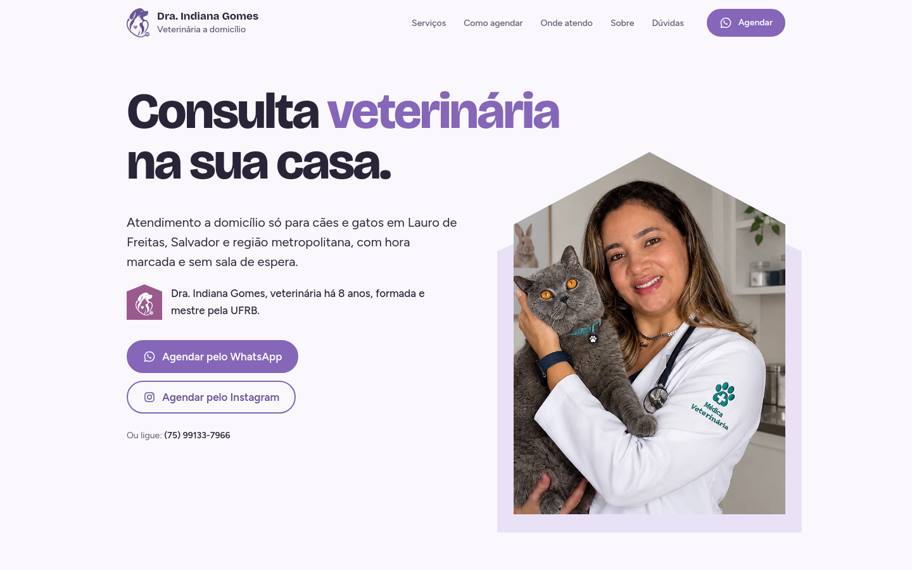
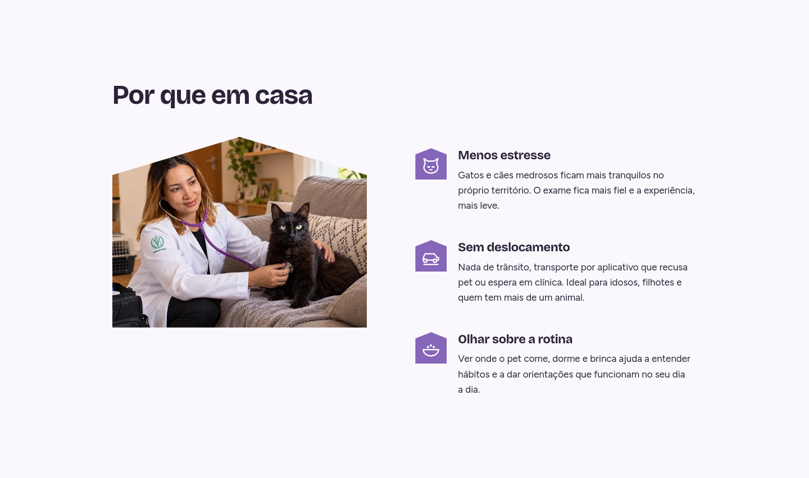
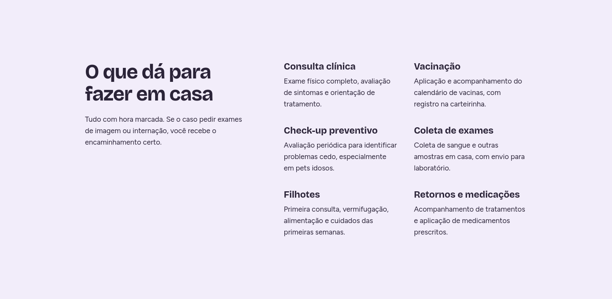
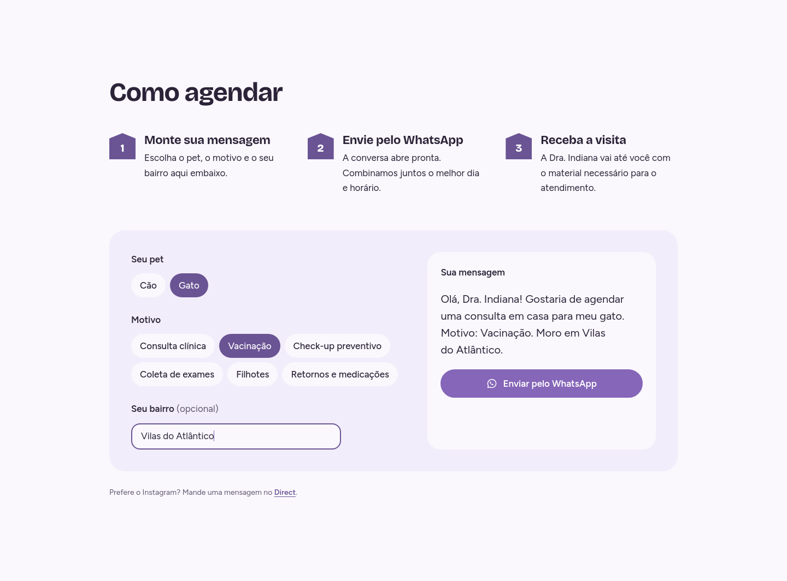
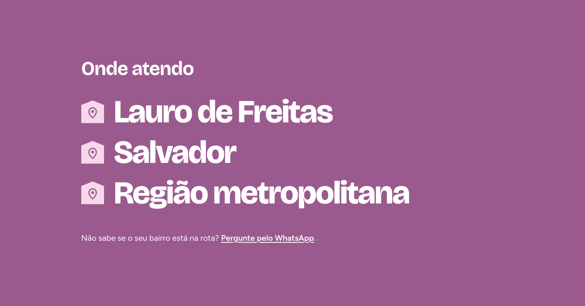
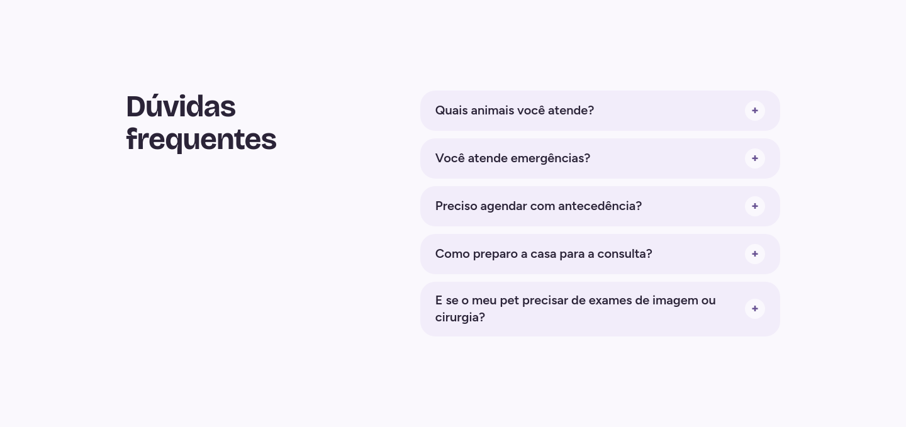
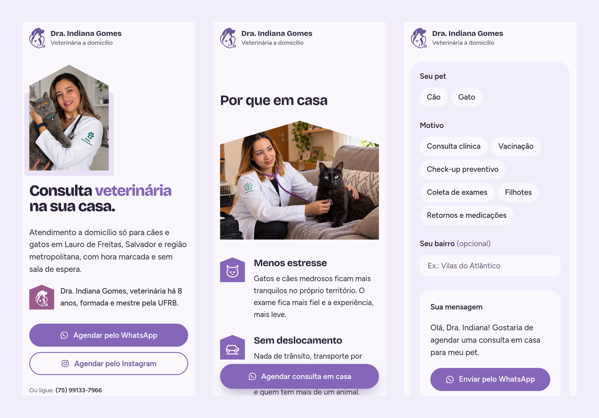

<div align="center" id="top">
  

  &#xa0;
</div>

<h1 align="center">Dra. Indiana Gomes - Veterinária a domicílio</h1>

<p align="center">
  

  

  

  

  

  

  
</p>


<hr>

<p align="center">
  <a href="#-sobre">Sobre</a> &#xa0; | &#xa0;
  <a href="#telas-da-aplicação">Telas</a> &#xa0; | &#xa0;
  <a href="#skateboard-funcionalidades">Funcionalidades</a> &#xa0; | &#xa0;
  <a href="#rocket-tecnologias">Tecnologias</a> &#xa0; | &#xa0;
  <a href="#white_check_mark-requisitos-para-rodar-a-aplicação">Requisitos</a> &#xa0; | &#xa0;
  <a href="#checkered_flag-iniciando">Iniciando</a> &#xa0; | &#xa0;
  <a href="#gear-configurações-adicionais-ao-projeto">Configurações</a> &#xa0; | &#xa0;
  <a href="#memo-licença">Licença</a> &#xa0; | &#xa0;
  <a href="https://github.com/juniorvilas" target="_blank">Autor</a>
</p>

<br>

## 😸 Sobre ##

Site da Dra. Indiana Gomes, médica veterinária formada e mestre pela UFRB, com aprimoramento em Clínica Médica de Pequenos Animais, que atende cães e gatos a domicílio em Lauro de Freitas, Salvador e região metropolitana.
A landing page apresenta os serviços, a formação da veterinária e as áreas atendidas, e leva o tutor direto para o WhatsApp com a mensagem pronta para agendar a consulta em casa. O formato de casa da foto principal se repete pela página como marca visual do atendimento a domicílio.

## Telas da aplicação

### Tela Home Desktop ##


### Tela Por que em casa Desktop ##



### Tela Serviços Desktop ##



### Tela Como agendar Desktop ##



### Tela Sobre Desktop ##


### Tela Onde atendo Desktop ##



### Tela Dúvidas Desktop ##



### Telas Mobile ##



## :skateboard: Funcionalidades ##

:heavy_check_mark: Agendar consulta pelo WhatsApp com mensagem pronta\
:heavy_check_mark: Montador de mensagem: o tutor escolhe cão ou gato, o motivo e o bairro, e o WhatsApp abre preenchido\
:heavy_check_mark: Agendar pelo Direct do Instagram ou ligar direto pelo site\
:heavy_check_mark: Tempo de atuação calculado automaticamente a partir do ano em que a veterinária começou\
:heavy_check_mark: Formação, serviços, áreas atendidas e perguntas frequentes\
:heavy_check_mark: Barra de agendamento fixa no celular, que aparece só quando os outros botões saem da tela\
:heavy_check_mark: Entradas suaves ao rolar a página e resposta ao toque nos botões\
:heavy_check_mark: Layout responsivo do celular ao desktop\
:heavy_check_mark: Acessibilidade: navegação por teclado com foco visível e respeito a "reduzir movimento"\
:heavy_check_mark: SEO local: página pré-renderizada, dados estruturados de clínica veterinária, sitemap e imagem de compartilhamento


## :rocket: Tecnologias ##

Abaixo poderá ter acesso às principais tecnologias usadas neste projeto


- [React 19](https://react.dev/)
- [TypeScript](https://www.typescriptlang.org/)
- [Vite](https://vite.dev/)
- [Tailwindcss v4](https://tailwindcss.com/)
- [Vitest](https://vitest.dev/)


## :white_check_mark: Requisitos para rodar a aplicação ##

Antes de iniciar :checkered_flag:, você precisa ter [Git](https://git-scm.com) e [Node](https://nodejs.org/en/) 20 ou superior instalados em seu sistema operacional. Se usar o [nvm](https://github.com/nvm-sh/nvm), basta rodar `nvm use 20`.

## :checkered_flag: Iniciando ##

```bash
# Clone este projeto
$ git clone https://github.com/juniorvilas/veterinaria-indiana-gomes.git

# Acesse
$ cd veterinaria-indiana-gomes

# Instale as dependências
$ npm i

# Execute o projeto (abre em http://localhost:5173)
$ npm run dev

# Rode os testes
$ npm test

# Gere a versão de produção, já pré-renderizada, na pasta dist/
$ npm run build
```

## :gear: Configurações adicionais ao projeto ##

- **Conteúdo:** telefone, Instagram, formação, ano de início da atuação, serviços, áreas atendidas e perguntas frequentes ficam em `src/infrastructure/content/StaticPracticeRepository.ts`.
- **Arquitetura:** o código segue camadas no estilo DDD: `src/domain` (regras e modelo), `src/application` (casos de uso, como montar a mensagem do WhatsApp e o SEO), `src/infrastructure` (conteúdo) e `src/presentation` (componentes e seções). A composição fica em `src/composition.ts`.
- **SEO:** copie `.env.example` para `.env` e preencha `VITE_SITE_URL` com o domínio do site e, se quiser, `VITE_GOOGLE_SITE_VERIFICATION` com o código do Google Search Console. O build gera o HTML com as meta tags, os dados estruturados, o `sitemap.xml` e o `robots.txt` (`scripts/prerender.mjs`).
- **Imagens:** as fotos otimizadas (WebP com JPG de reserva), a logo e os ícones ficam em `public/img/`.
- **Estilos:** cores roxo pastel, fontes e escala tipográfica ficam no `@theme` de `src/index.css`. Botões, ícones e a casinha usada como marcador ficam em `src/presentation/components/`.
- **Animações:** a entrada das seções ao rolar fica em `src/presentation/motion/`, com as regras de transição em `src/index.css`.

## :memo: Licença ##

O código deste projeto está sob licença MIT. Para mais informações acesse [LICENSE](LICENSE.md).
O logo, as fotos e os textos são da Dra. Indiana Gomes e não fazem parte da licença.

Feito com :heart: por <a href="https://github.com/juniorvilas" target="_blank">Carlindo Junior</a>

&#xa0;

<a href="#top">Voltar ao topo</a>
